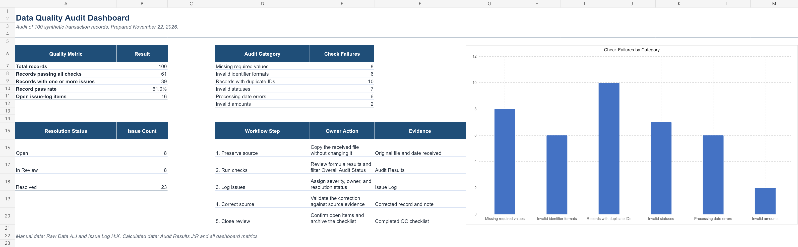
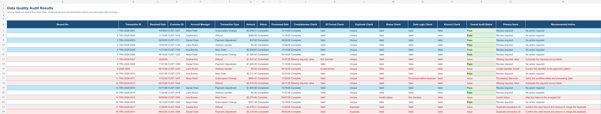
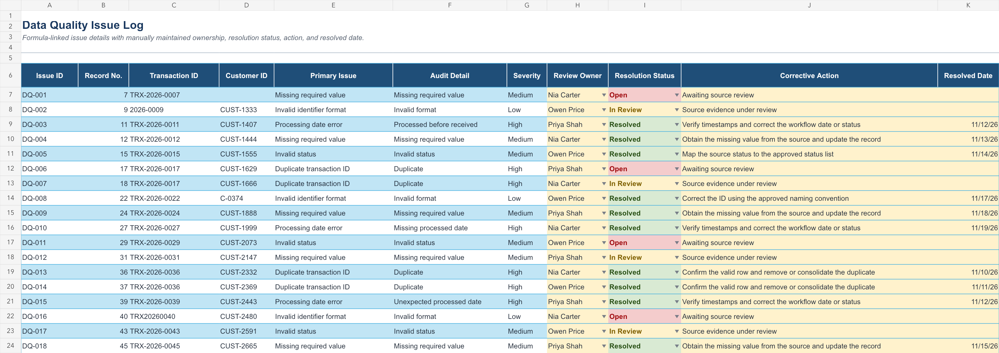
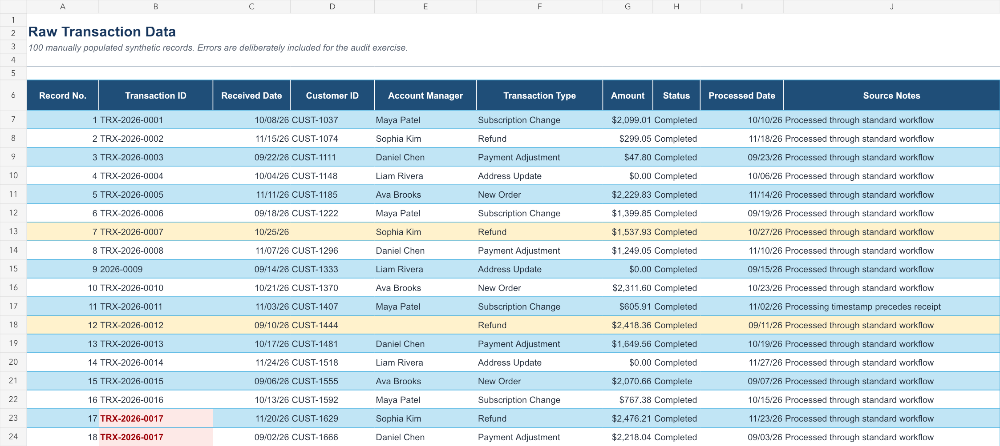
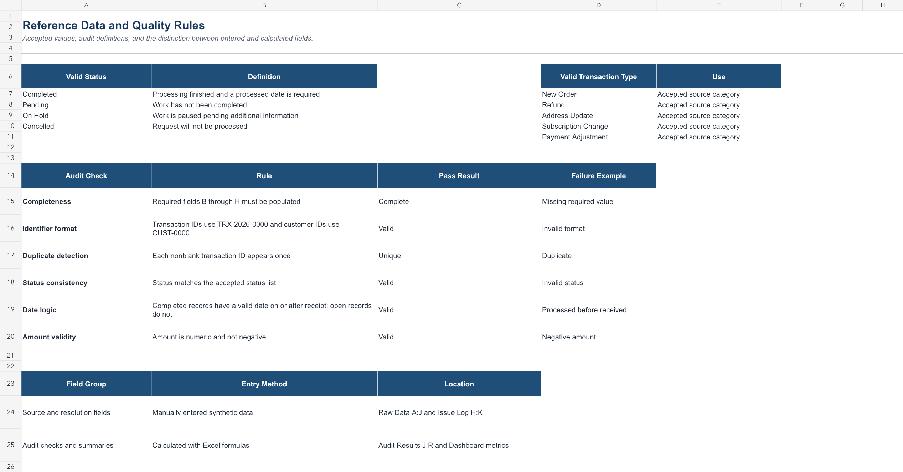

# Data Quality Audit and Process SOP

An Excel portfolio project that audits operational transaction records for missing values, invalid identifier formats, duplicate IDs, inconsistent statuses, date-processing errors, and invalid amounts. The project also includes a two-page standard operating procedure and quality-control checklist.

All records are synthetic. The project contains no real customer, employee, client, or employer data.

## Project objective

The project demonstrates how a data-operations team can:

- Preserve an unchanged source dataset
- Audit 100 transaction records with consistent quality rules
- Separate manually entered source data from calculated audit results
- Detect missing values, invalid formats, duplicates, inconsistent statuses, date errors, and invalid amounts
- Assign severity, ownership, corrective actions, and resolution status
- Summarize data quality and open work on a dashboard
- Document a repeatable review process in an SOP and checklist

## Deliverables

- [Data Quality Audit workbook](Data_Quality_Audit_and_Process_SOP.xlsx)
- [Data Quality Audit SOP PDF](Data_Quality_Audit_SOP.pdf)
- [Editable SOP document](Data_Quality_Audit_SOP.docx)

## Workbook structure

The workbook contains five worksheets:

1. **Dashboard** - record-level quality metrics, audit-category counts, issue-resolution status, a formula-linked chart, and the operating workflow
2. **Audit Results** - source fields linked from Raw Data plus formula-driven checks, overall status, primary issue, and recommended action
3. **Issue Log** - formula-linked issue information and manually maintained severity, owner, resolution status, corrective action, and resolved date
4. **Raw Data** - 100 manually populated synthetic transaction records containing controlled quality defects
5. **Reference Data** - accepted statuses and transaction types, audit-rule definitions, and the distinction between entered and calculated fields

## Manually entered and calculated data

### Manually entered data

The source dataset was created by populating the following fields for 100 fictional records:

- Record number
- Transaction ID
- Received date
- Customer ID
- Account manager
- Transaction type
- Amount
- Status
- Processed date
- Source notes

Controlled errors were deliberately inserted so each audit rule could be demonstrated. The Issue Log also contains manually maintained review owner, resolution status, corrective action, and resolved date fields.

### Calculated data

The Audit Results sheet links to the source and uses Excel formulas to calculate:

- Completeness check
- Identifier-format check
- Duplicate check
- Status check
- Date-logic check
- Amount check
- Overall audit status
- Primary issue
- Recommended action

The Dashboard then uses `COUNTIFS` and linked ranges to summarize the calculated audit results and issue-log status.

## Audit logic and formula examples

### Completeness

Checks whether all required fields are populated:

```excel
=IF(OR(B7="",C7="",D7="",E7="",F7="",G7="",H7=""),"Missing required value","Complete")
```

### Identifier format

Uses `LEFT` and `LEN` to test the required transaction-ID and customer-ID patterns:

```excel
=IF(OR(B7="",D7=""),"Not checked",IF(AND(LEFT(B7,9)="TRX-2026-",LEN(B7)=13,LEFT(D7,5)="CUST-",LEN(D7)=9),"Valid","Invalid format"))
```

### Duplicate detection

Counts each transaction ID in the complete source range:

```excel
=IF(B7="","Not checked",IF(COUNTIFS('Raw Data'!$B$7:$B$106,B7)>1,"Duplicate","Unique"))
```

### Status consistency

Uses `EXACT` so capitalization and spacing must match an approved status:

```excel
=IF(H7="","Not checked",IF(OR(EXACT(H7,'Reference Data'!$A$7),EXACT(H7,'Reference Data'!$A$8),EXACT(H7,'Reference Data'!$A$9),EXACT(H7,'Reference Data'!$A$10)),"Valid","Invalid status"))
```

### Processing dates

Tests whether completed records have a valid processed date on or after receipt and whether open records incorrectly contain a processed date. The check returns results such as `Missing processed date`, `Processed before received`, `Unexpected processed date`, or `Valid`.

### Overall audit status

Returns `Pass` only when all applicable record-level checks pass. Otherwise, it returns `Issue` and selects a primary issue and recommended action.

## Audit results

| Metric | Result |
| --- | ---: |
| Total records | 100 |
| Records passing all checks | 61 |
| Records with one or more issues | 39 |
| Record pass rate | 61.0% |
| Missing required values | 8 |
| Invalid identifier formats | 6 |
| Records with duplicate IDs | 10 |
| Invalid statuses | 7 |
| Processing date errors | 6 |
| Invalid amounts | 2 |

The 10 duplicate records represent five duplicated transaction-ID pairs. The simulated Issue Log contains 8 open items, 8 items in review, and 23 resolved items.

## SOP and quality-control checklist

The supporting SOP documents:

- Purpose, scope, and responsibilities
- Source preservation and structural review
- Formula-based audit execution
- Issue logging, severity, and ownership
- Correction and independent verification
- Review closure and record retention
- A 10-point quality-control checklist

## Excel skills demonstrated

- `IF`, `AND`, and `OR` for audit classification
- `LEFT`, `LEN`, and `EXACT` for format and status validation
- `COUNTIFS` for duplicate detection and dashboard metrics
- `ISNUMBER` for date and amount validation
- Cross-sheet references that preserve blank source cells
- Excel tables, filters, frozen panes, and dropdown validation
- Conditional formatting for failed checks and resolution status
- Formula-linked dashboard chart

## Suggested interview walkthrough

1. Start on Dashboard and explain that 61 of 100 records pass all checks.
2. Open Raw Data and explain that these are the manually populated source fields with deliberate defects.
3. Open Audit Results and trace one record from its linked inputs through the six calculated checks.
4. Filter Overall Audit Status to `Issue` and review the recommended corrective action.
5. Open Issue Log and explain how ownership, severity, resolution status, and evidence are maintained.
6. Show the SOP and quality-control checklist as the repeatable process used to run and close the audit.

## Resume bullet

- Audited 100 operational records for completeness and accuracy, identified 39 records requiring review, and created a step-by-step SOP and quality-control checklist for consistent processing.

## Limitations and possible extensions

This project is a static portfolio simulation rather than a production data-quality platform. Potential extensions include Power Query imports, business-rule configuration tables, protected formula columns, audit-history snapshots, automated issue-log creation, and Power BI reporting.

## Screenshots

### Dashboard



### Audit results



### Issue log



### Raw data



### Reference data



## Disclaimer

This independent portfolio project uses fictional records for learning and demonstration purposes. It does not represent data-quality work performed for a real employer or client.
